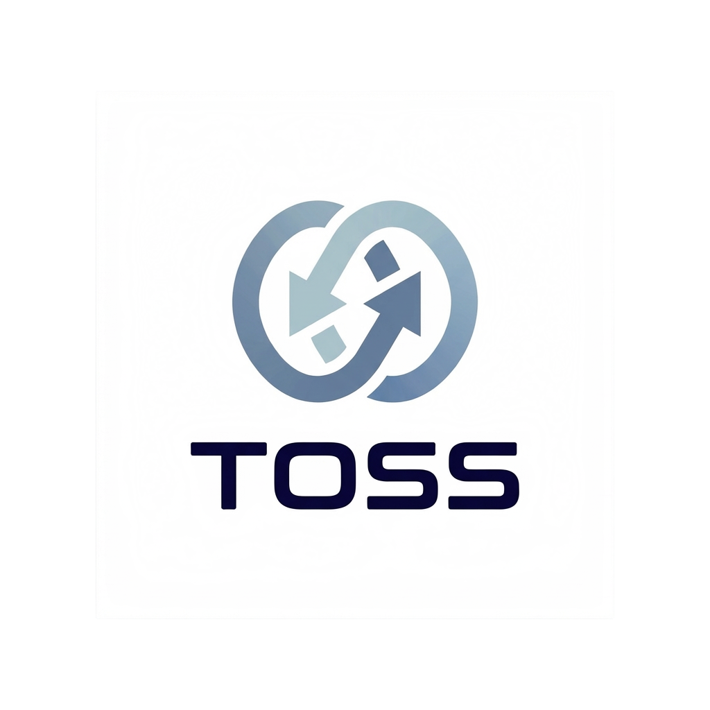

# Toss - 跨设备传输

<p align="center">
  
</p>

<p align="center">
  简单、快速、安全的跨设备文件和文本传输工具
</p>

<p align="center">
  🔒 端到端加密 · ⚡ 设备直传 · 📱 跨平台 · 💻 支持 PWA
</p>

## ✨ 特性

- **设备直传** - 基于 WebRTC 技术，传输内容优先在设备间直接发送
- **端到端加密** - 数据传输全程加密，并提供会话指纹供两端人工核对
- **连接链路可见** - 可查看当前连接是局域网直连、P2P 穿透还是服务器中转
- **无文件大小限制** - 传输速度取决于您的网络环境与当前连接方式
- **跨平台支持** - 支持手机、平板、电脑等任何现代浏览器设备
- **PWA 支持** - 可安装为本地应用，支持系统分享功能
- **暗色模式** - 支持浅色/深色主题切换
- **简洁易用** - 6 位房间代码，一键创建或加入

## 🖼️ 预览

创建或加入房间后，即可在设备间自由传输文本和文件：

- 📝 发送文本消息
- 📁 传输任意类型文件
- 🖼️ 图片预览与下载
- 📋 一键复制房间代码

## 🚀 快速开始

### 环境要求

- Node.js 22.12+（Capacitor 8 与 Vite 8 的共同要求）
- pnpm (推荐) 或 npm

### 安装

```bash
# 克隆项目
git clone https://github.com/your-username/toss.git
cd toss

# 安装依赖
pnpm install
```

### 运行

```bash
# 开发模式
pnpm dev

# 构建生产版本
pnpm build

# 运行生产版本
pnpm start
```

访问 http://localhost:3000 即可使用。

### 行动端本地入口（Capacitor）

P0 第二步已接入共用房间与传输页：创建／加入六位房间、双向文字与文件、接收确认、会话指纹、进度、取消和图片预览。移动端复用网站协议与加密，不是加载远端网站。网站和 PWA 保持原有入口。

固定版本：Capacitor core / CLI / Android / iOS 8.5.3、App 插件 8.1.2、Vite 8.3.4、React 插件 6.1.2。

```bash
# 浏览器开发：仅用于预览，不代表原生验证通过
pnpm mobile:dev

# 类型检查、生产构建、同步到两个原生工程
pnpm mobile:sync

# 预览生产产物：http://127.0.0.1:4173
pnpm mobile:preview

# 打开原生 IDE
pnpm mobile:open:android
pnpm mobile:open:ios

# 构建并在连接设备 / 已创建模拟器上运行
pnpm mobile:run:android
pnpm mobile:run:ios
```

配置在 `capacitor.config.ts`，本地资源来自 `mobile/dist`；不使用远端 `server.url`，不包含网站 Service Worker、manifest、Analytics 或 `/share` 导入流程。`components/app-shell.tsx` 和传输核心由两个入口共用，平台配置通过 `lib/app-runtime.tsx` 提供，不模拟 Next.js 环境变量。原生工程位于 `mobile/android`、`mobile/ios`，构建产物不提交；重新拉取后先运行 `pnpm install --frozen-lockfile` 和 `pnpm mobile:sync`。`app.toss.mobile` 是开发标识，商店发布前需设置正式 App ID、签名及图标。

Android 需要 Android Studio 2025.2.1+、JDK 21、SDK Platform 36、对应构建工具，以及连接设备或 AVD。新版 IDE 自带 JDK 25 时，请在 Gradle JDK 中另选 21；项目 Gradle 8.14.3 不支持使用 Java 25 运行。命令行构建需配置 `JAVA_HOME` 与 SDK 路径。iOS 需要 macOS、Xcode 26+；工程使用 Swift Package Manager，无需 CocoaPods。

入口配置：在 `mobile/.env.local` 设置 `VITE_PUBLIC_ROOM_ORIGIN=https://你的实际网站域名`，再执行 `pnpm mobile:sync`。未配置时仍可用房间码连接，但不生成本地 origin 的错误邀请二维码。

原生接收路径（`@capacitor/filesystem` 8.1.4）：收到的文件按块写入 App **私有目录** `toss-received/`（iOS `Library`、Android 内部 files），传输中先写 `*.part`，完成后再原子改名为最终文件名；重名自动追加序号，文件名去除路径分隔与控制字符。WebView 不再聚合整文件 Blob，单块经 Base64 桥接且上限由 `FILE_CHUNK_MAX_SIZE` 约束。原生下不再用 WebView 源配额预检，改由真实写入错误判定空间不足。**接收不会自动出现在系统「文件」App 中**：暂存目录是用户不可见的私有位置，iOS 也不再开启文件共享暴露 Documents。

原生扫码（`@capacitor/barcode-scanner` 3.1.3）：App 内扫码走系统相机，不申请 WebView 摄像头权限，也不再调用 `getUserMedia`；取消返回后仍可手动输入或上传二维码图片。网站继续使用浏览器相机。

系统分享接收（Android `ACTION_SEND`、iOS Share Extension）：分享进来的内容先复制到 App 私有暂存 `toss-inbox/`，再进入待发队列，不会自动出现在用户可见目录。iOS 扩展依赖 App Group 与真实开发者团队描述文件，必须在 Xcode 中确认签名与 App Group 后才能真机验证。

存储清理：App 启动时清理中断传输残留的 `*.part` 分片与超过 24 小时的分享暂存；**不删除已完成接收的文件**，因为那是用户尚未导出的内容。用户可见的删除与容量管理属后续步骤。

传输失败语义：接收端拒绝、空间不足或落盘失败都会通过 `file-error` 通知发送端，发送端显示为**失败**而不是"已取消"或"已完成"，避免假成功。

已知限制：分享进来的文件经 `fetch(convertFileSrc(uri))` 读入 WebView 内存后再发送，大文件会占用与其大小相当的内存；有界发送需发送端接受 range-read 来源，属后续步骤。

可选信令配置为 `VITE_PEER_HOST`、`VITE_PEER_PORT`、`VITE_PEER_PATH`、`VITE_PEER_SECURE`；默认与网站相同的公共 PeerJS 和 STUN。网站对应 `NEXT_PUBLIC_PEER_*`、`NEXT_PUBLIC_ROOM_ORIGIN`，保留原有 `NEXT_PUBLIC_TURN_*`。移动包不嵌入长效 TURN 密码，短效凭证仍属后续工作；当前不保证受限网络互通。

验证记录（2026-10-12）：移动类型检查、Vite 构建、两平台 sync、Next.js 构建及 64 项行为测试通过；变更文件 ESLint 无错误（3 项普通 `` 优化建议）。Android Debug APK、iOS 模拟器包构建通过。浏览器运行移动生产入口与网站，双向文字、会话指纹、双向 100 MiB 文件及 SHA-256 校验通过；拒收、等待确认时取消、图片预览、深浅色和 390px 无横向溢出已检查。原生接收存储在 iOS 模拟器真实运行时写入 65541 字节文件并核对字节内容通过。**这些不是 Android／iOS 真机互传验收。**

真机验证：在两平台 IDE 重新运行同步后的 App，用同一信令配置的网站创建／加入房间。先双向发送文字，再选择 100 MiB 与 1 GiB 文件并由接收端确认；记录设备、系统、网络、耗时、内存、取消／失败状态，并对接收内容校验 SHA-256，同时确认设备上的实际落盘文件。Android↔Web、iOS↔Web、Android↔iOS 仍需逐项实测；不能用模拟器启动或 API 存在代替。

完整后续范围见 [Capacitor 行动 App 计划书](docs/product/capacitor-mobile-app-plan.md)。

## 📖 使用方法

### 基本流程

1. **创建房间** - 在一台设备上点击「创建房间」，获得 6 位房间代码
2. **加入房间** - 在另一台设备上输入房间代码并点击「加入」
3. **开始传输** - 连接成功后，即可发送文本或文件

### PWA 安装

在支持 PWA 的浏览器（如 Chrome、Edge、Safari）中，可以将 Toss 安装为本地应用：

- **桌面端**: 点击地址栏右侧的安装图标
- **移动端**: 使用浏览器菜单中的「添加到主屏幕」

### 系统分享 (Web Share Target)

安装 PWA 后，可以直接从其他应用分享文件到 Toss：

1. 在任意应用中选择「分享」
2. 选择 Toss 作为分享目标
3. 内容会自动加载，连接设备后即可发送

## 🛠️ 技术栈

- **框架**: [Next.js 16](https://nextjs.org/) + [React 19](https://react.dev/)
- **样式**: [Tailwind CSS 4](https://tailwindcss.com/)
- **UI 组件**: [Radix UI](https://www.radix-ui.com/)
- **P2P 通信**: [PeerJS](https://peerjs.com/) (WebRTC)
- **图标**: [Lucide React](https://lucide.dev/)
- **主题**: [next-themes](https://github.com/pacocoursey/next-themes)

## 📁 项目结构

```
├── app/                    # Next.js App Router
│   ├── page.tsx           # 主页面
│   ├── layout.tsx         # 根布局
│   ├── share/             # Web Share Target API 路由
│   └── globals.css        # 全局样式
├── components/            # React 组件
│   ├── room-panel.tsx     # 房间面板（创建/加入）
│   ├── transfer-panel.tsx # 传输面板（消息列表）
│   ├── transfer-item.tsx  # 传输项（文本/文件）
│   └── ui/                # 基础 UI 组件
├── lib/                   # 工具库
│   ├── transfer-context.tsx # 传输状态管理
│   ├── types.ts           # TypeScript 类型
│   └── utils.ts           # 工具函数
├── hooks/                 # 自定义 Hooks
│   └── use-share-target.ts # Web Share Target Hook
├── public/                # 静态资源
│   ├── manifest.json      # PWA 配置
│   └── sw.js              # Service Worker
└── styles/                # 样式文件
```

## 🔒 安全说明

- **传输内容**：文本和文件内容优先通过 WebRTC 数据通道在设备间直接发送，不由 Toss 服务端存储。
- **连接建立**：建立连接时需要通过 PeerJS 信令服务器交换建链信息。信令仅用于协调连接，不承载实际传输内容。
- **连接方式**：根据网络环境不同，实际链路可能表现为局域网直连、NAT 穿透后的 P2P 直连，或经 TURN 服务器中转。
- **链路加密**：所有 WebRTC 数据通道默认启用 DTLS 加密；即使在 TURN 中转场景下，传输链路仍受 WebRTC 加密保护。
- **会话校验**：连接建立后会显示短会话指纹，可在两端人工核对当前会话是否一致。

## 🧭 连接模型

为了避免歧义，可以把 Toss 的连接过程理解成两段：

1. **先建立连接**：应用通过信令服务交换建链信息，让两台设备找到彼此。
2. **再传输内容**：连接建立后，文本和文件通过 WebRTC 链路传输，默认不在 Toss 服务端存储。

当网络限制较少时，链路通常会直接建立在两台设备之间；当网络限制较强时，链路可能回退到 TURN 中转，但传输仍由 WebRTC 加密保护。

## 🤝 贡献

欢迎提交 Issue 和 Pull Request！

## 📄 许可证

[MIT License](LICENSE)

---

<p align="center">
  Made with ❤️ for seamless cross-device transfer
</p>
