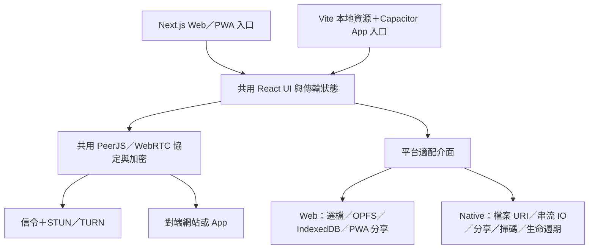

# Toss 行動 App 開發計劃書：Capacitor 方案

## 1. 決策摘要

**建議採用 Capacitor，保留現有 Web／PWA，新增共用程式碼的 Android／iOS App。**

產品定位：免帳號的跨裝置文字與檔案傳輸工具。桌面端繼續使用瀏覽器，手機端透過 App 提升選檔、儲存、掃碼與系統分享體驗。首版以**前景可靠傳輸**為核心，不承諾鎖屏持續傳輸、背景常駐接收或完全離線建房。

推薦技術路線：現有 Next.js 網站不改成純靜態站；新增 React＋Vite 的行動端入口，由 Capacitor 載入本地打包資源，共用 UI、傳輸協定與加密實作。Capacitor 不要求改用 Ionic UI，也不需要重寫為 React Native。

本文件是開發規劃，不代表原生平台能力已完成驗證。WebRTC、原生檔案橋接與分享擴充必須通過第一階段真機驗證後，才確定正式支援矩陣和效能承諾。

## 2. 現有項目基礎與改造依據

| 已核對的項目 | 現況 | 對行動 App 的影響 |
| --- | --- | --- |
| `package.json` | Next.js 16.2.1、React 19.2.4、PeerJS 1.5.5、Tailwind CSS 4；未引入 Capacitor | React UI 與傳輸邏輯可作為共用基礎，原生工程需要新增 |
| `components/app-client-page.tsx` | Client Component，組合房間、傳輸與 PWA UI | 可抽出共用畫面；網站和 App 使用不同入口 |
| `lib/transfer-room.ts`、`lib/transfer-connection.ts` | PeerJS／WebRTC 建鏈、連線管理 | 首版保留傳输協定，優先驗證 App 與現有網站互通 |
| `lib/transfer-data.ts`、`lib/transfer-protocol.ts` | 分塊傳輸、流量控制、取消與含 offset 的重連續傳路徑 | 可重用；目前程式碼不能直接證明 App 被殺後仍可續傳 |
| `lib/receive-storage.ts` | OPFS → IndexedDB → 記憶體；完成結果為瀏覽器 `File` | 需要原生串流落盤實作與 URI 型態；避免大檔案全量轉成 Blob／Base64 |
| `app/share/route.ts` | 動態 POST／GET／DELETE，使用 Node.js 暫存檔案，分享入口接受檔案總量上限 50 MiB | 不能直接放進靜態 App；行動 App 接收分享需走原生入口 |
| `components/qr-code-display.tsx` | 房間 URL 取自 `window.location.origin` | App 不能把本地 WebView origin 當作跨裝置邀請網址 |
| `lib/peer-config.ts` | 公共 PeerJS 信令、公共 STUN；TURN 由 `NEXT_PUBLIC_*` 設定 | 上線前需安排可控的信令／TURN；正式包不能嵌入長效 TURN 密碼 |
| 圖片、房間與設定元件 | 使用 `next/image`、`next/dynamic`、`process.env` 等 | 共用區需解除 Next 專屬耦合；不是把全站原封不動交給 Vite |
| `lib/receive-history-storage.ts`、可信裝置相關程式 | 已有收件歷史、裝置資訊與信任功能 | 保留既有行為，再補原生檔案的持久引用和清理規則 |

**需明確區分的安全邊界：**一般 WebRTC 傳輸與 PWA 分享入口不是同一条資料路徑。現有 `/share` 會將使用者分享的內容暫存於網站伺服器；不能把所有入口一概描述成「檔案從不上傳伺服器」。App 的原生分享方案應只在裝置本地暫存。

### 已完成的現況核驗

- 啟動現有 Next.js 開發服務，在 Chromium 以 390 × 844 viewport 開啟首頁並截圖。
- 此尺寸下頁面內容寬度為 390，未觀察到首頁橫向溢出；房間與收件區為上下排列。
- 實際輸入文字並加入離線隊列，畫面顯示「待发送内容已排队，连接后自动发送」與「1 段文本」。
- 尚未驗證兩裝置 WebRTC、Android WebView、iOS WKWebView、鎖屏或真機選檔；上述瀏覽器核驗不能替代原生測試。

## 3. 首版範圍

### 必須交付

1. **跨端連線**：建立／加入六位房間碼、掃碼加入、房間連結；Android ↔ Web、iOS ↔ Web、Android ↔ iOS 雙向互通。
2. **前景傳輸**：文字、圖片、任意一般檔案、多檔佇列、接收確認、進度、速度、取消及失敗提示；保留既有風險二次確認與會話指紋。
3. **原生檔案操作**：系統選檔、App 私有目錄接收、匯出到使用者指定位置、交由其他 App 開啟／分享；處理重名、容量不足及來源 URI 失效。
4. **系統分享進入 Toss**：Android 接收單檔／多檔／文字／網址；iOS Share Extension 將內容加入本地待發佇列。
5. **本地收件箱**：完成的原生檔案及對應記錄在 App 重啟後仍可開啟；提供刪除、容量與暫存清理操作。清除記錄與刪除檔案的語義分開。
6. **行動端操作**：鍵盤避讓、瀏海與手勢區、安全區、Android 返回鍵、深淺色、權限拒絕與恢復流程。
7. **生命週期**：切換背景、回前景、斷網及 Wi-Fi／行動網路切換後，不錯誤顯示傳輸完成；提供重新連線與重新傳送入口。
8. **正式發佈**：簽名 Android AAB、TestFlight／iOS 發佈包、隱私文件、商店素材及可重複構建流程。

### 不納入首版

- iOS／Android 通用的鎖屏持續 WebRTC 傳輸、被系統終止後自動接收。
- App 重啟後跨會話斷點續傳；本機持久待發佇列不等於傳輸續傳。
- 手機端主動共享螢幕；現有 `getDisplayMedia` 不能當作已具備手機錄屏能力。接收桌面螢幕串流另行真機驗證，不作首版核心驗收。
- LAN 自動探索、無網際網路建房、資料夾遞迴傳輸、帳號與雲端檔案同步。
- 靜默持續讀取剪貼簿、推播喚醒即可完成傳輸。

暫定測試基線為 Android 10+、iOS 16+；這是產品規劃，不是 Capacitor 最低支援版本。第一階段根據選定 Capacitor／插件版本、WebView 与真機結果鎖定最終版本範圍。

## 4. 架構選型

| 路線 | 優點 | 本項目的代價／風險 | 決策 |
| --- | --- | --- | --- |
| Capacitor 載入遠端網站 | 接線少，網站更新立即生效 | 首次啟動依賴網站、WebView 橋接邊界與審核風險；官方 `server.url` 用於開發而非正式方案 | 不作正式架構 |
| Next.js 靜態匯出＋Capacitor | 保留同一套 Next 打包流程 | 動態 `/share`、headers 不支援靜態匯出；若保留網站功能，仍需分離路由與服務端責任 | 不選為主路線 |
| **共用 React 核心＋Vite 行動入口＋Capacitor** | 網站服務端功能不受影響；App 包含本地資源；平台邊界明確 | 需解除少量 Next 耦合，維護兩個入口及構建流程 | **推薦** |

### 責任分層

### 建議的工程安排

- 保留根目錄 `app/` 為網站；新增 `mobile/` 放置 `index.html`、React 入口、Vite 與 Capacitor 設定、Android／iOS 原生工程。
- 初期直接共用既有 `components/`、`hooks/`、`lib/`，只按實際需要新增平台適配檔案，不先做全庫 monorepo 重組。
- 抽出共用 AppShell；PWA 註冊、manifest 與網站 Analytics 留在 Web 入口，App 不註冊網站 Service Worker、不顯示 PWA 安裝提示。
- `next/image` 在共用圖片元件中改為適合兩端的普通圖片實作，保留尺寸、懶載入、錯誤與預覽處理；`next/dynamic` 改為 React lazy／平台入口載入。
- 公開房間域名、信令、ICE、開發模式改為入口提供的具名設定，不在 Vite 中模擬整個 `process.env`。
- 保留 Web 的 `/share` 和 Node 暫存實作，但不讓行動端 import graph 包含它們。
- Capacitor `webDir` 指向 Vite 的實際產物目录；正式包不使用遠端 `server.url`，不開放任意 WebView 導航。
- 新增 mobile 構建／sync 腳本，將原生工程與鎖檔納入版本控制。插件以相容 Capacitor 8 的維護版本為起點，完成驗證後固定版本。

## 5. 關鍵實施設計

### 5.1 檔案收發：以串流與 URI 為核心

目前發送依賴 `File.slice(...).arrayBuffer()`，接收完成依賴 `File`／Blob URL。只把瀏覽器下載按鈕改成 `Filesystem.writeFile` 不足以完成原生改造。

- 發送來源介面提供檔名、MIME、大小及 `readRange(offset, length)`；Web 包裝 `File`，Native 使用受授權 URI 或 App 私有暫存檔。
- 接收沿用 `appendChunk／finalize／abort` 責任，新增 Native 實作。完成結果區分 Web File 与 Native URI，更新預覽、開啟、分享、刪除及歷史記錄所有消費端。
- 小設定與檔案索引用 Preferences 或小型本地索引；檔案內容放私有持久目錄，不把收到的檔案長期放 Cache。首版不因「App」而自動引入 SQLite。
- Native 分塊橋接採有界佇列與背壓；允許單塊 Base64 橋接但禁止整檔 Base64。量測橋接次數、記憶體与吞吐，必要時批次處理或實作專用串流插件。
- Android 用 Storage Access Framework／內容 URI；iOS 用文件選擇器與必要的 security-scoped access。先匯入本地待發區，避免分享來源授權到期後無法發送。
- 接收完成後才原子提交檔案與索引；失敗、取消、磁碟不足不留下「已完成」記錄。清理殘留臨時檔，不刪除已匯出到 App 外的使用者檔案。
- 分享輸入逐檔處理，先檢查可用空間；不可沿用整批檔案同時載入記憶體的做法。

### 5.2 系統分享：傳出去與分享進來是兩件事

- `@capacitor/share` 用來把 Toss 內容分享给其他 App，**不提供接收其他 App 分享的完整實作**。
- Android：原生處理 `ACTION_SEND`／`ACTION_SEND_MULTIPLE`，支援冷啟動與既有 Activity；複製受授權內容至本地，記錄唯一分享批次，App 消費後確認，避免重複加入。
- iOS：新增 Swift Share Extension＋App Groups；擴充顯示加入 Toss 的結果，將檔案及 manifest 存入共享容器；主 App 下次啟動／回前景匯入佇列。
- **不承諾 iOS 分享後自動跳到主 App**，不使用繞過系統限制的非公開啟動方法。第一階段驗證 Photos、Files、Safari 的實際分享交付。
- 不把 PeerJS 或長時間傳輸塞入 Share Extension。分享完成提示說明「已加入 Toss，開啟 App 後傳送」。

### 5.3 房間連結與掃碼

- 所有房間 QR／分享連結使用固定公開 HTTPS 網站域名和既有 `?join=` 格式，不使用 App 的 `capacitor://localhost`／本地 origin。
- 配置 iOS Universal Links、Android App Links、AASA／assetlinks；安裝 App 時可交給 App，未安裝时仍可使用網站。
- 同時處理冷啟動 URL 與 `appUrlOpen`；驗證域名、路徑与房間碼，不能把任意外部網址導入具原生能力的 WebView。
- 掃碼採經真機驗證且維護中的 Capacitor 原生條碼插件；不把 `@capacitor/camera` 當成條碼解碼器。權限拒絕後仍能手動輸入房間碼。

### 5.4 前景、背景與中斷

- 監聽 App 生命週期与網路變更，回前景檢查實際資料通道，不只依賴 `navigator.onLine`。
- 使用者開始傳輸時可選擇保持螢幕喚醒，完成／取消後釋放；這不是背景傳輸方案。
- 背景可能中斷時提示需要保持前景。回來後保留檔案與可恢復狀態；既有同會話重連續傳只在確認對端已接收 offset 后沿用，不將「已發送位元組」等同「接收端已落盤」。
- 被殺進程後，保留已完成收件及待發內容，將未完成任務標為中斷並提供重新發送；不偽造成功或宣稱跨重啟續傳。
- Capacitor Background Runner 不是 WebRTC 常駐容器：它不是 WebView，亦受平台執行期限约束。Android 前景服務＋原生傳輸引擎與 iOS 可行背景模式屬於另案，不可只靠一個插件承諾兩端背景互通。

### 5.5 安全、網路与隱私

- 保留現有加密、會話指紋、接收確認與風險提示；不新增明文傳輸降級。可信裝置標記不等於已經過強身分認證。
- Native 檔名與檔案 URI 不直接取自對端路徑，禁止路徑穿越；HTML／SVG 等不可信檔案不能在有 Capacitor bridge 的同源頁面執行。
- 上線配置可控信令、STUN 与 TURN，提供受限網路下的 TLS／TCP relay 路徑；需要新增受控的短效 TURN 憑證端點，不把長效密碼寫進 App 或 `NEXT_PUBLIC_*`。
- 信令／TURN 服務不存檔案；TURN 會轉發流量并產生頻寬費用。網站 PWA `/share` 暫存例外需單獨披露。
- 在 App 初次使用時不一次索取所有權限；依掃碼、選檔、通知操作按需請求。不默讀剪貼簿，不預設上報文字、檔名、檔案內容或房間碼。
- 本地通知僅反映 App 已收到的事件，不承諾系統終止後的遠端接收提醒。首版無推播後端。
- 核對插件隱私 manifest、iOS 用途說明、Android Data Safety；是否包含 App 內分析工具須在上線前明確決定与申報。

## 6. 實施排期與里程碑

**規劃估算：兩位工程師、一位兼任 QA／設計，8–10 週到具備提審條件。**工程師需覆盖 React／Capacitor 與 Swift／Kotlin；商店審核、帳號申請與外部採購時間不計入。若單人需同時補原生技能，規劃窗口為 12–16 週；這不是交付保證。

| 階段 | 時間 | 工作與可觀察交付 | 放行條件 |
| --- | --- | --- | --- |
| P0 可行性與風險驗證 | 第 1 週 | Android／iOS 最小本地包；WebRTC＋Web Crypto；兩端與網站互傳；100 MiB／1 GiB 串流 IO；分享擴充與背景行为實驗 | 两平台核心互通、記憶體不隨檔案線性增長；若失敗先調整方案再正式投入 |
| P1 共用核心與 App 工程 | 第 2–3 週 | Vite 入口、框架耦合清理、平台介面、Android／iOS 構建、鍵盤與安全區、設定與本地佇列 | 網站原有流程不退化；兩平台可安裝并進入傳輸頁 |
| P2 原生檔案與傳輸闭環 | 第 4–5 週 | 選檔、原生分塊讀寫、預覽／匯出／分享、重名與容量不足、收件重啟持久化、取消與中斷 | 文字／檔案雙向传输、端到端內容校验、失敗無假成功 |
| P3 系統入口與正式網路 | 第 6–7 週 | Android 分享接收、iOS Share Extension、公開邀請連結、原生掃碼、短效 TURN、生命週期恢复 | 冷／熱啟動分享及链接通过；強制 relay 場景可传输 |
| P4 真機回歸與發佈 | 第 8–10 週 | 裝置／網路矩陣、效能調整、原有協定回歸、內測、隱私與素材、簽名与提審 | 下列驗收通過，無資料损坏、丢失或權限阻塞問題 |

可让 Android 先進入內測，但第一週就必須覆蓋 iOS；不能等 Android 做完後才發現 WKWebView 或 Share Extension 不符合產品预期。

## 7. 人力、設備與費用

### 必要資源

- 一位 React／Capacitor 工程師；一位熟悉 Swift／Kotlin 的工程師；QA／設計兼任。
- Mac＋符合所选 Capacitor 版本的 Xcode、至少一部 iPhone；Android Studio 与至少兩個品牌的 Android 真機。雲端 iOS 構建不能替代實機除錯。
- Apple／Google 開發者帳號、正式域名、簽名与證書管理、HTTPS 信令与 TURN 服務。
- 目前已核驗 Node.js 22.23.2、pnpm 10.33.0；Android SDK、Mac／Xcode、簽名帳號與真機可用性尚未核驗。

### 預算計算方式

人工預算 = 每位人員投入人週 × 对應人週成本；另列設備、開發者帳號、Mac CI、信令与 TURN 支出。沒有團隊單價或使用量時，不提供虛假的固定報價。

TURN 成本按「活躍用戶 × 每人傳輸量 × relay 占比 × 供應商計費規則」估算；上下行或出站流量如何計費取決於供應商。不要用信令服務低成本推估檔案中轉低成本。

## 8. 驗收與測試計劃

以下為**建議驗收目標，尚未量測達標**；P0 后固定測試设备、网络与檔案上限。

| 類別 | 必須驗收的行為 |
| --- | --- |
| 互通 | Android↔Web、iOS↔Web、Android↔iOS，各方向完成文字、圖片及檔案傳輸；不改壞網站既有房間与協定 |
| 網路 | 同 Wi-Fi、跨網路 Wi-Fi／行動網路、強制 TURN、關網及切網；宣告建鏈失敗不能无限停在成功外觀 |
| 大檔案 | 1 MiB、100 MiB、1 GiB 檔案；完成後對比 SHA-256；記錄原生 RSS／WebView 記憶體，不能出現与檔案大小線性增长的全檔缓存 |
| 檔案邊界 | Unicode／重名檔案、多檔、0-byte、來源被移除、空間不足；明確成功／拒絕／失敗，不靜默跳過 |
| 分享接收 | Android 冷／熱啟動单檔、多檔与文字；iOS Photos／Files／Safari 分享後，本地佇列在主 App 可讀且不重複消费 |
| 檔案持久性 | 重啟後完成收件可開啟；刪除後記錄與私有檔案一致；不誤刪已匯出的檔案 |
| 生命週期 | 背景、鎖屏、回前景、强制結束後状态準確；未完成任务不能標記完成；已完成資料仍保留 |
| 安全 | 未接受不收檔、風險二次確認保留；惡意檔名不越界；HTML／SVG／外部網址不能取得原生橋接能力 |
| UI | 小螢幕、瀏海、鍵盤、深淺色、Android 返回鍵、權限拒絕；主要操作觸控區至少 44 × 44 CSS px，無橫向溢出 |
| 發佈 | Release 本地資源可離線打開 UI 与历史；清楚提示建房仍需要信令；簽名、隱私 manifest 与商店申報完整 |

效能評估先看正確性与有界記憶體，再看吞吐。P0 建立同设备／同網路／同檔案的浏览器基線，之后决定可接受的 App 开销；不預先承諾固定 MB/s 或「無檔案大小限制」。檔案最大值由空間、设备与實測支援範圍决定。

回歸保留現有协议、接收風險与储存测试，對新改的行為边界補測試；選檔、分享擴充、權限、生命週期与串流 IO 必須有真機結果，不能只靠 mock 或單元測試放行。

## 9. 主要風險與應對

| 風險 | 應對 |
| --- | --- |
| WKWebView／Android WebView 的 WebRTC、Web Crypto 与本地 origin 差異 | P0 先做真機互通，保持受支援默认来源配置；不能以桌面浏览器通过代替 |
| 大檔案造成 JS／原生橋接瓶頸或 OOM | 有界分塊 IO、背壓、原生落盤；禁止整檔 Base64／Blob；把記憶體曲线纳入验收 |
| iOS 分享流程不會像 Android 直接打開 App | App Groups 暫存佇列，明确「開啟 Toss 後傳送」；不使用非公開 API |
| 背景傳輸期待與平台限制衝突 | 首版文案明确前景模式；後续如要求背景，先独立研究傳輸引擎与平台合規性 |
| 公共信令可用性或受限网络造成建鏈失敗 | 正式环境采用可控信令与 TURN，驗證 TLS relay；仍保留直連与中轉資訊 |
| 雙入口演變成兩套產品邏輯 | 協定、加密、状态与通用 UI 共用；平台差異只放適配层，Web／App 同步回歸 |
| 純網頁包裝缺少原生價值／商店審核不確定 | 首版交付原生選檔、分享入口、本地收件箱、匯出与生命週期處理；留出審核整改窗口 |
| 收到的內容或網站 Analytics 与隐私承諾不一致 | 按入口说明資料路徑；App 預設不承接網站分析；逐項核對第三方 SDK 与本地备份行为 |

## 10. 交付清單

1. 可安装的 Android／iOS App 与受版本控制的原生工程。
2. 共用 UI／傳輸核心与 Web、Native 適配實作；没有舊行動端路径或假平台 shim。
3. 原生檔案收發、分享接收、掃碼、公开邀请链接与持久收件箱的完整闭环。
4. 正式信令／TURN 与短效凭证設定、域名关联文件、權限與隱私 manifest。
5. 裝置／網路测试結果、檔案校验与記憶體曲线、已知平台限制。
6. Web 与 mobile 的构建／签名／發佈说明、隱私政策、商店素材、首版 changelog。

## 11. 下一步啟動順序

先啟動 P0，**不先大规模重構 UI**：

1. 接入固定版本 Capacitor 与最小 Vite 行動入口，让兩平台載入本地頁面。
2. 直接复用現有 PeerJS、協定与加密，完成手机 ↔ 网站文字／100 MiB 檔案验证。
3. 實作最小 Native range-read／chunk-write 路径，驗證 1 GiB 与磁碟不足；记录橋接与記憶體代价。
4. 驗證 Android 分享与 iOS Share Extension＋App Groups；測量前背景行为。
5. 固定支援矩陣与範圍，进入共用介面与正式功能开发。

只有當核心前景传输在兩平台通过时，才將 8–10 週規劃轉成正式开发里程碑。若業務要求「iOS 鎖屏也能持續接收大檔案」，必须先修改產品与架构假设，不能把它当作 Capacitor 套壳的附带能力。

### 实施记录（更新至 2026-10-12）

- 已接入固定版本 Capacitor 8.5.3、App 插件 8.1.2、Vite 8.3.4 与 React 插件 6.1.2；保留 `mobile/android` 与 `mobile/ios`（SPM）工程。
- 使用者已确认 Android／iOS 本地启动、平台识别与原生桥接通过；该反馈未说明两平台真机互传已通过。原启动检查页已切换为实际共用传输页。
- **P0 第二步代码已接入，真机互通验收待完成**：复用房间、PeerJS、协议、加密、接收确认与风险二次确认，支持文字／File 收发、进度、取消、图片预览和会话指纹。共用 UI 解除 `next/image`／`next/dynamic` 耦合，平台入口提供信令／ICE／邀请域名；PWA 分享导入、Service Worker 与 Analytics 留在网站。
- 实际浏览器互通发现并修复最大文件块密文上限遗漏 12-byte IV＋16-byte 标签；100 MiB 双向传输 SHA-256 一致。另修复等待接收确认时取消不生效及接收确认弹窗不撤销，保留真实行为回归测试，移除仅匹配源码字符串的实现约束测试。
- 移动类型检查、Vite／Next.js 构建、两平台 sync、64 项行为测试通过；变更 ESLint 无错误（3 项普通图片优化建议）。Android Debug APK 和 iOS 模拟器包构建通过。浏览器完成文字、文件、拒收、待确认取消、图片预览与主题验证。原生接收存储在 iOS 模拟器真实运行时写入 65541 字节文件，`*.part` 原子改名提交、字节内容核对通过。模拟器启动和浏览器互传不能代替原生跨端验收。
- **P0 第三步原生文件 IO 已接入，真机验收待完成**：新增 `@capacitor/filesystem` 8.1.4，接收端按块写入 App 私有目录 `toss-received/`，先写 `*.part` 再原子改名，重名加序号，文件名去路径分隔与控制字符；WebView 不再聚合整文件 Blob。发送端沿用 `File.slice()` 有界区间读取。原生下不再用 WebView 源配额预检，改由真实写入失败判定。
- 接收完成的文件恢复下载图标：原生端点击后经 `@capacitor/share` 8.0.3 打开系统分享面板保存到「文件」App 或其他应用；Android 补 `files-path` 授权。
- **修正接收即暴露文件的问题**：iOS 的 `Directory.Data` 实为 Documents 目录，配合 `UIFileSharingEnabled` 会让文件在用户确认前就出现在系统「文件」App。现改为暂存到用户不可见的私有 `Library`，并移除 iOS 文件共享键；只有点击保存才导出。
- 大文件验证（浏览器移动入口 ↔ 网站，同一机器）：1 GiB 双向传输 SHA-256 一致；接收期间 JS 堆采样 196 次，峰值 246 MB、结束回落 8 MB，未随文件大小线性增长。**该结果来自浏览器环境，不能替代原生真机的内存与落盘验证。**
- 未实现：跨重启持久收件箱、原生扫码、系统分享接收、短效 TURN；`*.part` 残留与私有暂存的清理规则仍待补。
- `VITE_PUBLIC_ROOM_ORIGIN` 必须是实际公开 HTTPS 网站 origin；未配置时可用房间码，不生成本地邀请链接。
- 下一放行条件仍是 Android↔Web、iOS↔Web、Android↔iOS 真机双向文字／100 MiB 文件和内容校验。随后继续 1 GiB／容量不足、内存曲线、分享与生命周期实验；P0 尚未完成。

## 12. 官方參考

- [Capacitor 安裝與本地資源要求](https://capacitorjs.com/docs/getting-started)
- [Capacitor 配置：webDir、local origin、server.url 的用途](https://capacitorjs.com/docs/config)
- [Capacitor 8 開發環境：Node 22+、macOS／Xcode 與 Android Studio](https://capacitorjs.com/docs/getting-started/environment-setup)
- [Next.js 靜態匯出與不支援的動態服務端功能](https://nextjs.org/docs/app/guides/static-exports)（目前官方頁面版本為 16.4；項目為 16.2.1，實施時仍需以項目版本构建驗證）
- [Capacitor Share：向其他 App 分享](https://capacitorjs.com/docs/apis/share)
- [Capacitor Filesystem：目錄、原生資料格式與隱私 manifest](https://capacitorjs.com/docs/apis/filesystem)
- [Capacitor Universal Links／App Links](https://capacitorjs.com/docs/guides/deep-links)
- [Capacitor Background Runner 與執行限制](https://capacitorjs.com/docs/apis/background-runner)
- [Apple App Extension 生命週期与限制](https://developer.apple.com/library/archive/documentation/General/Conceptual/ExtensibilityPG/ExtensionOverview.html)（官方归档，用于说明扩充边界；具体 SDK 支援仍需真机验证）
- [Apple App Groups 配置](https://developer.apple.com/documentation/xcode/configuring-app-groups)
